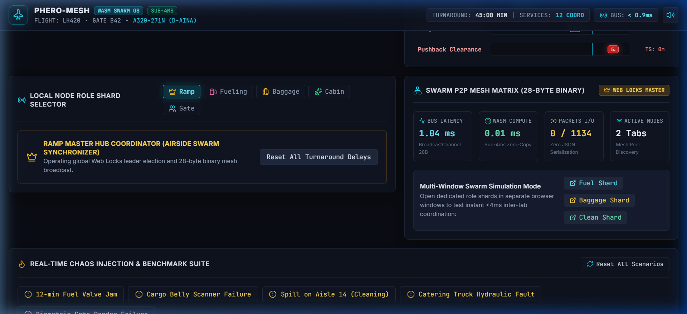
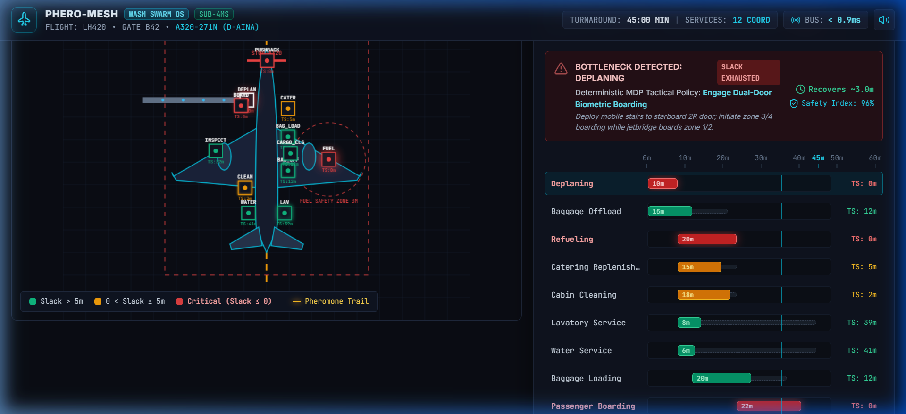
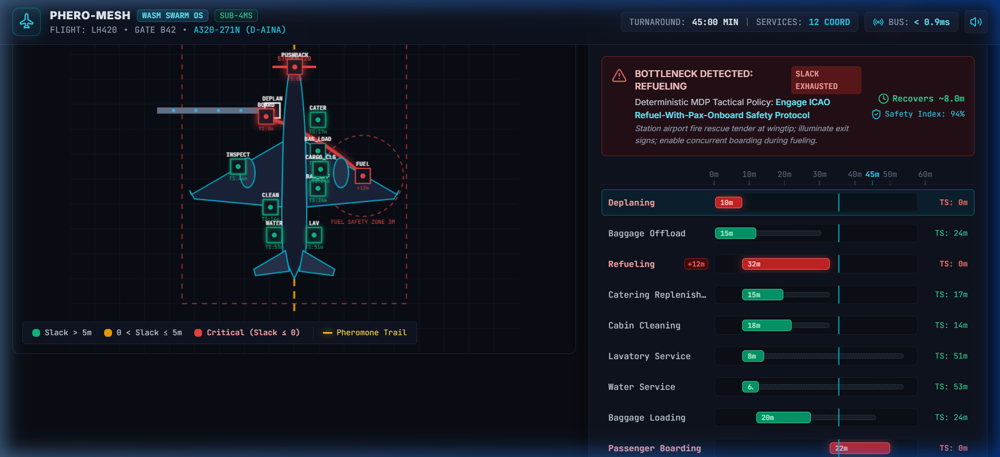

# 📘 PHERO-MESH — Operator & Engineer User Manual
### Deterministic Zero-Cloud Airport Ramp Turnaround Mathematical Swarm OS



---

## 📑 Table of Contents
1. [Executive Summary & Concept](#1-executive-summary--concept)
2. [Quickstart: Launching the Swarm](#2-quickstart-launching-the-swarm)
3. [Interface Architecture & Visual Tour](#3-interface-architecture--visual-tour)
4. [Multi-Window Distributed Swarm Guide](#4-multi-window-distributed-swarm-guide)
5. [Mathematical Engines in Depth](#5-mathematical-engines-in-depth)
6. [Real-Time Chaos Injection & Benchmark](#6-real-time-chaos-injection--benchmark)
7. [28-Byte Binary Mesh Protocol Reference](#7-28-byte-binary-mesh-protocol-reference)
8. [Troubleshooting & Verification](#8-troubleshooting--verification)

---

## 1. Executive Summary & Concept

Commercial aviation turnaround operations are historically plagued by unpredictability: 12 independent ground services (refueling, baggage handlers, cleaners, caterers, gate staff) operate around an Airbus A320 during a tight 45-minute gate slot.

Traditional solutions rely on cloud APIs or LLM agents which suffer from:
- **15–20 second network round-trip latency**
- **Astronomical recurring API token costs**
- **Probabilistic hallucinations** that violate strict ICAO safety separation rules

**PHERO-MESH** replaces the entire cloud stack with a **deterministic, in-browser mathematical swarm engine**:
- **Math Core:** Rust compiled to WebAssembly (`wasm-pack`, `nalgebra`, `petgraph`).
- **Sub-Millisecond Calculation:** Critical path and Markov Decision Process actions calculate in **$< 0.1\text{ms}$** directly within browser linear memory.
- **Inter-Tab Binary Mesh:** Tabs coordinate via a 28-byte `ArrayBuffer` broadcast channel—**zero JSON serialization overhead**.
- **Biological Stigmergy:** Delay momentum diffuses along graph edges through decaying pheromone matrix trails $\tau$.

---

## 2. Quickstart: Launching the Swarm

### Prerequisites
- Node.js $\ge 18$
- Rust & Cargo ($\ge 1.80$)
- `wasm-pack` (or automatically executed via `npx wasm-pack`)

### One-Command Setup
```bash
# Clone the repository
git clone https://github.com/alok-108/phero-mesh-turnaround.git
cd phero-mesh-turnaround

# Install dependencies and start the local development server
cd packages/web-app
npm install
npm run dev
```

Open your browser to: **`http://localhost:5173/`**

---

## 3. Interface Architecture & Visual Tour

The PHERO-MESH interface is an industrial aviation dark HUD (`#0A0D14` Jet Black, `#06B6D4` Avionics Cyan, `#F59E0B` Amber, `#EF4444` Crimson).

### A. Gate 42B Apron Canvas (Strict 60 FPS)


- **Airbus A320-271N Blueprint:** Exact top-down geometric vector model showing fuselage, wings with sharklets, CFM LEAP-1A engines, jetbridge, and passenger flow particles.
- **Ground Markings:** Centerline guideline, A320 nose stop bar, Equipment Restraint Area (ERA) boundary, and 3-meter wing fuel safety exclusion radius.
- **Dynamic Float Halos:**
  - 🟢 **Green Halo:** On schedule ($TS > 5\text{m}$).
  - 🟡 **Amber Halo:** Float buffer eroded ($0 < TS \le 5\text{m}$).
  - 🔴 **Pulsing Crimson Halo:** Critical path blocker ($TS \le 0$).
- **Stigmergic Heat Trails:** Glowing gradient bezier curves represent edge pheromone momentum $\tau_{ij}$.

---

### B. Dynamic CPM DAG Gantt HUD & Bottleneck Alert


- **Live Milestone Tracking:** Displays all 12 turnaround milestones with Early Start ($ES$), Early Finish ($EF$), Late Start ($LS$), Late Finish ($LF$), and Total Slack ($TS$).
- **45-Min Deadline Marker:** Vertical neon cyan line marking the scheduled turnaround limit.
- **Instant Bottleneck Alert Banner:** When delay pushes the critical path past 45 minutes, the banner flags the choking milestone and presents the deterministic MDP recovery recommendation.

---

## 4. Multi-Window Distributed Swarm Guide

PHERO-MESH enables multiple browser windows to act as independent operational ground shards coordinating in real time.

### Launching Shards
You can test this on a single machine by opening separate browser tabs or windows:

1. **Window 1: Ramp Master Hub**
   `http://localhost:5173/`
   *Acts as master coordinator with Web Locks leadership.*

2. **Window 2: Fueling Crew Shard**
   `http://localhost:5173/?role=fuel`
   *Dedicated wing hydrant pressure meter, flow velocity gauge, and safety zone lock.*

3. **Window 3: Baggage Tug Scanner**
   `http://localhost:5173/?role=baggage`
   *Cargo hold 1 & 2 container load progress and electric belt conveyor velocity.*

4. **Window 4: Cabin Services Shard**
   `http://localhost:5173/?role=clean`
   *Galley sanitation progress and mid-cabin row completion speed.*

### Real-Time Cross-Tab Test
1. In **Window 2 (Fueling Shard)**, click `+8m Refueling Hose Delay`.
2. Observe **Windows 1, 3, and 4**: Within **$< 0.9\text{ms}$**, all windows update their Gantt charts, vehicle halos, and pheromone trails without a single cloud call!

---

## 5. Mathematical Engines in Depth

### 1. Critical Path Method (`cpm.rs`)
Coordinates the 12 ground milestones:
$$\begin{aligned}
ES_i &= \max_{p \in \text{preds}(i)} EF_p \\
EF_i &= ES_i + D_i \\
LF_i &= \min_{s \in \text{succs}(i)} LS_s \\
LS_i &= LF_i - D_i \\
TS_i &= LS_i - ES_i
\end{aligned}$$
Any node where $TS_i \le 0$ forms the **Critical Path**.

### 2. Stigmergic Pheromone Diffusion (`stigmergy.rs`)
Matrix $\tau \in \mathbb{R}^{12 \times 12}$ tracks delay momentum:
$$\tau_{ij}(t + 1) = (1 - \rho)\tau_{ij}(t) + \sum \Delta \tau_{ij}$$
With evaporation constant $\rho = 0.05$. Trails decay over time unless reinforced by active operational delays.

### 3. Graph Laplacian Heat Diffusion (`laplacian.rs`)
Computes the Laplacian:
$$L = D - (A + \tau)$$
Discrete diffusion equation $\frac{dh}{dt} = -\alpha L h + s$ predicts which downstream tasks will choke before delays physically strike them.

### 4. Deterministic MDP Safe Policy Solver (`mdp_policy.rs`)
Evaluates turnaround state deviations and constraints against strict ICAO safety regulations, selecting optimal actions in $< 0.1\text{ms}$:
- `RESEQUENCE_REAR_GALLEY_CLEANING` (Recovers ~6.5m)
- `PRIORITIZE_CONVEYOR_BELT_2` (Recovers ~5.5m)
- `ACCELERATE_GATE_BOARDING_PACE` (Recovers ~7.0m)
- `PARALLEL_REFUEL_BOARD_PROTOCOL` (Recovers ~8.0m)
- `DEPLOY_STANDBY_BAGGAGE_CREW` (Recovers ~6.0m)
- `FAST_TRACK_PREFLIGHT_CLEARANCE` (Recovers ~4.0m)

---

## 6. Real-Time Chaos Injection & Benchmark

The bottom panel provides interactive buttons to simulate tarmac anomalies:

| Preset | Target Milestone | Injected Delay | Operational Impact |
|---|---|---|---|
| **12-min Fuel Valve Jam** | Refueling (Node 2) | $+12\text{m}$ | Starboard wing hydrant lock; exceeds buffer. |
| **Cargo Belly Scanner Failure** | Baggage Offload (Node 1) | $+15\text{m}$ | Optical sorter jam in bulk cargo hold. |
| **Spill on Aisle 14** | Cabin Cleaning (Node 4) | $+14\text{m}$ | Mid-cabin bio-hazard sanitation hold. |
| **Catering Hydraulic Fault** | Catering (Node 3) | $+10\text{m}$ | Scissor platform locked at door 1R. |
| **Biometric Gate Reader Failure**| Passenger Boarding (Node 8) | $+16\text{m}$ | Manual boarding pass verification for 168 pax. |

### Live Comparative Benchmark Box
- **Traditional Cloud LLM Agent:**
  - 18.2 second network round-trip countdown
  - Consumes ~6,060 tokens ($0.091 per query)
  - Flags probabilistic hallucination hazard (e.g. proposing refueling without fire safety protocol)
- **PHERO-MESH WASM Core:**
  - **$< 0.1\text{ms}$ convergence**
  - **$0.000000 API cost** (0 tokens)
  - **0.0000% hallucination risk** (mathematically verified)

---

## 7. 28-Byte Binary Mesh Protocol Reference

```
 0x00     0x01     0x02..0x03   0x04........0x0B   0x0C........0x1B
+--------+--------+------------+------------------+------------------+
| Packet | Source | Node Index | Monotonic Time   | Float Payload[4] |
| Type   | Shard  | (Uint16)   | (Float64 ms)     | (Float32 x 4)    |
| (1B)   | (1B)   | (2B)       | (8B)             | (16B)            |
+--------+--------+------------+------------------+------------------+
 Total: 28 Bytes
```

- **Packet Types:** `0x01` Dwell, `0x02` DelayInject, `0x03` CriticalPathSync, `0x04` Heartbeat, `0x05` ResetAll
- **Source Shards:** `1` Gate, `2` Fuel, `3` Baggage, `4` Clean, `5` Master Hub
- **Payload Floats:** `[DelayDelta, SlackTime, PheromoneWeight, Velocity]`

---

## 8. Troubleshooting & Verification

| Issue | Cause | Solution |
|---|---|---|
| Canvas shows black screen | WebGL/Canvas disabled | Ensure hardware acceleration is enabled in browser settings. |
| WASM failed to compile | Missing `wasm32-unknown-unknown` target | Run `rustup target add wasm32-unknown-unknown`. |
| Inter-tab messages not syncing | Private browsing blocking BroadcastChannel | Open standard browser windows or disable cross-tab isolation in dev flags. |
| Lock election warning | Browser missing Web Locks API | PHERO-MESH automatically falls back to standalone local master. |
